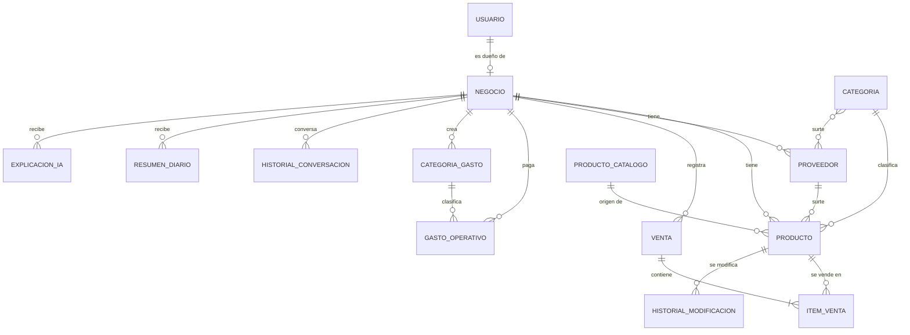

# Base de datos de marIA

Aquí está todo lo de la base de datos: cómo instalarla, cómo está armada y cómo cargarle datos. El proyecto usa **PostgreSQL**; si no se configura nada, sigue funcionando con SQLite (el archivo `db.sqlite3`) para poder probarlo rápido.

## 1. ¿Por qué PostgreSQL y no SQLite?

SQLite guarda todo en un solo archivo y está pensado para proyectos chicos. Cuando cargamos más de 1,000 productos y 16,000 ventas, las pantallas empezaron a tardar. PostgreSQL es un servidor de base de datos de verdad:

- Atiende varias consultas al mismo tiempo sin bloquear el archivo.
- Maneja índices y restricciones (por ejemplo, que un precio no sea negativo) directamente en la base de datos.
- Carga muchos registros de golpe mucho más rápido.
- Azure lo ofrece como servicio, así que migrar a la nube después es solo cambiar los datos de conexión en el `.env`.

Además de cambiar de base de datos, se hicieron tres cosas para que cargue rápido: **índices** (ver sección 5), **paginación** (las tablas muestran 25 renglones por página) y **cache** de los datos que más se piden (alertas, ventas de hoy, catálogo para el asistente).

## 2. Instalación paso a paso (Windows)

1. Descarga el instalador de PostgreSQL desde <https://www.postgresql.org/download/windows/> y ejecútalo. Deja el puerto en `5432` y anota la clave que le pongas al usuario `postgres`.
2. Abre `database/crear_base.sql` y cambia `cambia_esta_clave` por la clave que quieras para la base de datos de marIA.
3. Crea la base y el usuario (desde la carpeta del proyecto). Si `psql` no se reconoce, usa la ruta completa, por ejemplo `"C:\Program Files\PostgreSQL\16\bin\psql.exe"`:

```bash
psql -U postgres -f database/crear_base.sql
```

4. En tu archivo `.env` (si no existe, copia `.env.example`) llena los datos de conexión:

```
DB_NAME=maria_db
DB_USER=mariamiga
DB_PASSWORD=la_clave_que_pusiste
DB_HOST=localhost
DB_PORT=5432
```

5. Con el entorno virtual activado, instala las librerías y crea las tablas:

```bash
python -m pip install -r requirements.txt
python manage.py makemigrations
python manage.py migrate
python manage.py seed_catalogo
```

Para volver a SQLite, deja `DB_NAME=` vacío en el `.env`.

## 3. Cargar los datos de un CSV

El comando `importar_csv` mete los productos y las ventas de golpe (en paquetes de 1,000 registros) en vez de guardarlos uno por uno, que es lo que hacía tan lenta la carga.

```bash
python manage.py importar_csv --usuario correo@tienda.com --productos productos.csv --ventas ventas.csv
```

- `--usuario` es el correo, teléfono o usuario del dueño de la tienda a la que se le cargan los datos (debe haberse registrado antes).
- Columnas de `productos.csv`: `nombre`, `categoria`, `costo`, `precio_venta`, `cantidad_actual`, `cantidad_minima`, `stock_ideal`. Solo `nombre` y `precio_venta` son obligatorias.
- Columnas de `ventas.csv`: `fecha`, `folio`, `producto`, `cantidad`, `precio_unitario`. Un renglón por producto vendido; los renglones con el mismo `folio` forman un solo ticket. El nombre del producto debe existir en `productos.csv`.
- Si tus columnas se llaman distinto, agrega el nombre a las listas de `ALIAS` al inicio de `core/management/commands/importar_csv.py`.
- `--limpiar` borra antes los productos y ventas de esa tienda (pide confirmación).
- Hay archivos de ejemplo en `database/ejemplos/`.

## 4. Cómo está armada

Todas las tablas que guardan información de la tienda llevan `negocio_id`, así cada dueño solo ve lo suyo. Las categorías de producto son compartidas por todas las tiendas.



### Tablas

| Tabla | Para qué sirve | Campos importantes |
|---|---|---|
| `accounts_usuario` | Quien inicia sesión. | `username`, `password`, `email`, `telefono` (único), `nombre_completo` |
| `accounts_negocio` | Datos de la tienda. | `usuario_id` (uno a uno), `nombre_tienda`, `alcaldia`, `anios_operacion`, `regimen_resico`, `rfc` |
| `inventario_categoria` | Categorías de producto (Bebidas, Lácteos…). | `nombre` (único), `icono` |
| `inventario_proveedor` | Proveedores de la tienda. | `negocio_id`, `nombre`, `telefono`, `correo` |
| `inventario_proveedor_categorias` | Qué categorías surte cada proveedor (muchos a muchos). | `proveedor_id`, `categoria_id` |
| `inventario_productocatalogo` | Catálogo genérico que se ofrece al registrarse. | `nombre`, `categoria_id`, `precio_sugerido` |
| `inventario_producto` | Productos reales de cada tienda. | `negocio_id`, `nombre`, `costo`, `precio_venta`, `cantidad_actual`, `cantidad_minima`, `stock_ideal`, `activo`, `pendiente_validacion` |
| `inventario_historialmodificacionproducto` | Motivo de cada cambio a un producto. | `producto_id`, `usuario_id`, `motivo` |
| `ventas_venta` | Un ticket. | `negocio_id`, `folio`, `estado` (EN_CURSO, COBRADA, CANCELADA), `total` |
| `ventas_itemventa` | Cada renglón del ticket. | `venta_id`, `producto_id`, `cantidad`, `precio_unitario` |
| `finanzas_categoriagasto` | Categorías de gasto que crea el tendero. | `negocio_id`, `nombre` |
| `finanzas_gastooperativo` | Gastos fijos y variables. | `negocio_id`, `categoria_id`, `tipo` (FIJO, VARIABLE), `concepto`, `monto`, `fecha` |
| `avi_historialconversacion` | Mensajes del chat con el asistente. | `negocio_id`, `rol`, `mensaje` |
| `avi_resumendiario` | El resumen de "cómo te fue ayer" (uno por día). | `negocio_id`, `fecha`, `texto` |
| `avi_explicacionia` | Explicación de la IA del dashboard y los reportes. | `negocio_id`, `tipo`, `fecha`, `huella`, `texto` |

Todas llevan también `id` (llave primaria), `creado_en` y `actualizado_en`.

### Decisiones que tomamos

- **El dinero va en `DECIMAL(10,2)`**, nunca en decimales de punto flotante, para que las sumas no pierdan centavos.
- **Los productos no se borran**: se dan de baja con `activo = false`, porque las ventas antiguas apuntan a ellos (`ItemVenta.producto` está protegido contra borrado). El campo `pendiente_validacion` distingue un producto "no encontrado" que se vendió al vuelo de uno dado de baja.
- **El precio queda guardado en cada renglón** (`precio_unitario`), así si el producto cambia de precio, los tickets viejos no cambian.
- **El semáforo de reabastecimiento no se guarda**, se calcula con `cantidad_actual`, `cantidad_minima` y `stock_ideal` (así nunca queda desactualizado).

## 5. Índices y restricciones

Además de los índices que Django crea solos en las llaves foráneas, se agregaron estos para las consultas más frecuentes:

| Índice | Tabla | Para qué |
|---|---|---|
| `producto_negocio_activo_idx` (`negocio_id`, `activo`) | producto | Listar el catálogo y las alertas de una tienda. |
| `producto_negocio_nombre_idx` (`negocio_id`, `nombre`) | producto | Búsquedas por nombre. |
| `venta_negocio_estado_fecha_idx` (`negocio_id`, `estado`, `creado_en`) | venta | Ventas cobradas por rango de fechas (dashboard y reportes). |
| `gasto_negocio_fecha_idx` (`negocio_id`, `fecha`) | gasto | Gastos del mes. |
| `conversacion_negocio_fecha_idx` (`negocio_id`, `creado_en`) | historial del chat | Los últimos mensajes de la conversación. |

Restricciones (la base de datos rechaza datos que no tienen sentido):

| Restricción | Regla |
|---|---|
| `producto_precios_no_negativos` | `costo >= 0` y `precio_venta >= 0` |
| `producto_cantidades_no_negativas` | `cantidad_actual`, `cantidad_minima` y `stock_ideal` mayores o iguales a 0 |
| `folio_unico_por_negocio` | No se repite el folio dentro de una tienda |
| `venta_total_no_negativo` | `total >= 0` |
| `item_cantidad_positiva` | `cantidad > 0` en cada renglón del ticket |
| `item_precio_no_negativo` | `precio_unitario >= 0` |
| `gasto_monto_positivo` | `monto > 0` |
| `resumen_avi_unico_por_dia` | Un solo resumen del asistente por tienda y día |
| `explicacion_unica_por_dia` | Una sola explicación por tienda, tipo y día |

## 6. Consultas útiles

En `database/consultas_utiles.sql` hay consultas ya escritas (ventas por día, productos más vendidos, semáforo de reabastecimiento, gastos por mes…) para abrir en pgAdmin o `psql`.

## 7. Respaldo

```bash
pg_dump -U mariamiga -d maria_db -f respaldo_maria.sql
```

Para restaurarlo en una base vacía: `psql -U mariamiga -d maria_db -f respaldo_maria.sql`.
